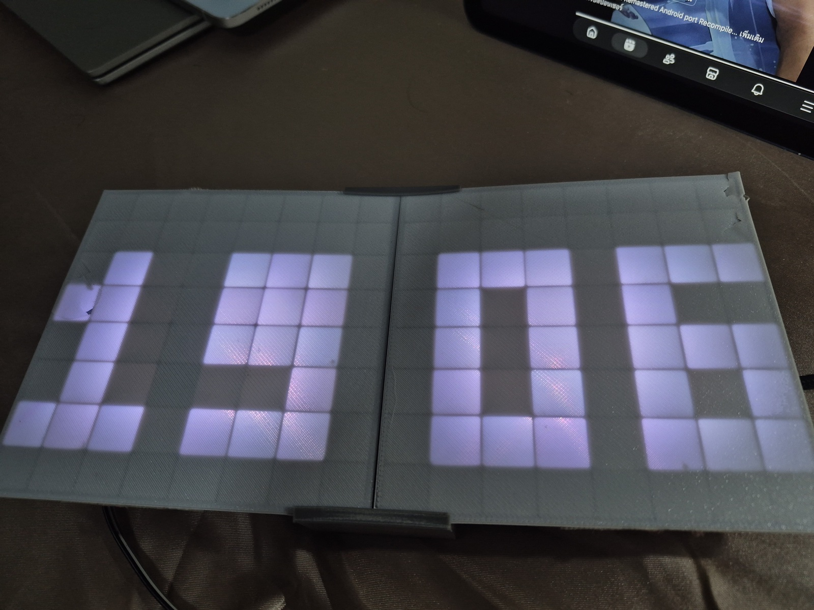
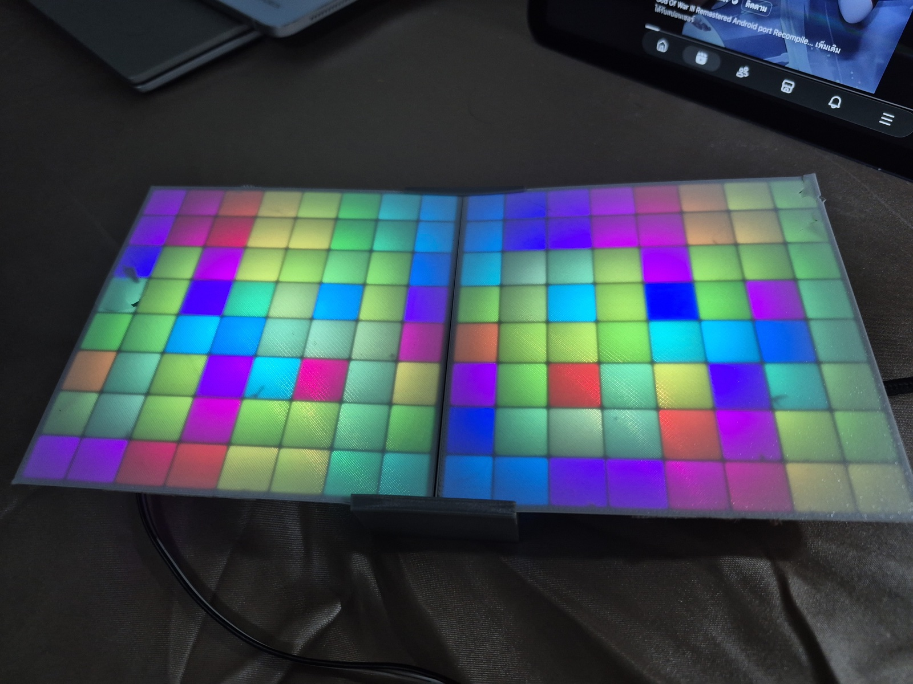

# LED Matrix (ESP32-S2 Mini)

A 16 × 8 NeoPixel matrix driven by a Lolin/WEMOS S2 Mini, with WLED-style effects, a clock overlay, a web UI, and WiFi setup via captive portal.

| Clock overlay | Background effect |
| --- | --- |
|  |  |

## Hardware

- Lolin / WEMOS S2 Mini (`lolin_s2_mini`)
- 128 × WS2812/NeoPixel LEDs on **GPIO 16**
- Layout: column-major, bottom to top. LED index = `col * 8 + row` (row 0 = bottom). LED 0 is bottom-left.
- BOOT button (GPIO 0) is used for the WiFi reset gesture.

## Features

- **Effects** (16 total, ported from WLED): Digital Rain, Pride 2015, Gradient, Sinelon, Plasma, Ripple Rainbow, Pacifica, Candle Multi, Solid Glitter, Dynamic Smooth, Blends, Chunchun, Sine, TwinkleUp, Drip, Popcorn.
- **Clock overlay**: HH MM in a 3×5 font, synced via NTP (UTC+7), with adjustable opacity and a color that follows the active effect.
- **Web UI** at `http://ledmatrix.local` (mDNS) or the device IP:
  - Toggle clock, background effects, random order, and each effect individually
  - Switch interval (3 s – 1 h, logarithmic slider)
  - Clock opacity slider
  - Change WiFi
- **WiFi setup portal** (WiFiManager): if no WiFi is saved, the device opens an AP named `LEDMatrix-Setup`. Setup mode blinks LED 0 yellow.
- **Reset WiFi**: hold the BOOT button for 3 seconds (LED 0 turns red while held).
- Settings are stored in flash (NVS) and survive reboots.

## Build & flash

Requires [PlatformIO](https://platformio.org/).

```sh
pio run -t upload
pio device monitor   # optional
```

Libraries (declared in `platformio.ini`): Adafruit NeoPixel, WiFiManager.

## Configuration

Edit `src/config.h`:

| Macro | Purpose |
| --- | --- |
| `WIFI_SETUP_AP` | Setup access point name (`LEDMatrix-Setup`) |
| `WIFI_SETUP_PASS` | Setup access point password (min 8 chars, empty = open) |
| `WIFI_PORTAL_SEC` | Seconds to wait in setup mode before restarting |
| `MDNS_HOSTNAME` | mDNS name (`ledmatrix` → `ledmatrix.local`) |
| `NTP_SERVER`, `TZ_OFFSET_SEC`, `NTP_RESYNC_MS` | Time sync settings |

Adjust `BRIGHTNESS` in `src/matrix.h` (default 40 of 255) to limit current draw.

## Project layout

```
src/
├── main.cpp            # setup/loop, effect rotation, layer compositing
├── matrix.h/.cpp       # LED strip, Pixel type, layer buffers
├── registry.h/.cpp     # list of effects shown in the UI
├── effect.h            # base class for effects
├── effects/            # one .h/.cpp per effect
├── clock_layer.*       # HH MM overlay
├── net_time.*          # WiFi, WiFiManager portal, mDNS, NTP
├── settings.*          # persistent settings (Preferences / NVS)
├── web_ui.*            # HTTP server and HTML/JS page
├── wave.*              # sine/beat helpers
└── color.*             # color helpers
```

### Adding an effect

1. Create `src/effects/my_effect.h` and `.cpp`, deriving from `Effect` and implementing `begin()`, `frame()` (draw into `layer0`), `frameMs()`, and `accentColor()`.
2. Register it in `src/registry.cpp` (instance + `effectList` entry). Raise `MAX_EFFECTS` in `registry.h` if you exceed 16.

## Notes

- The setup AP password is stored in `src/config.h`. Change it before sharing the repository publicly.
- The web UI has no authentication. Anyone on the same network can change settings.
- Some effects are simplified ports: palettes are replaced with HSV rainbows, and TwinkleUp uses its own PRNG.

## License

Not specified yet.
